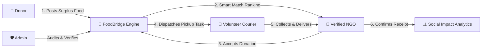
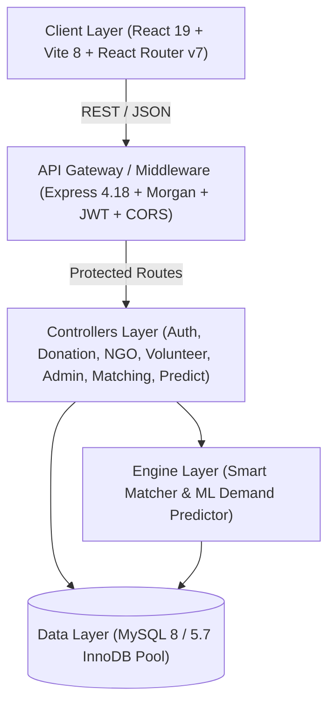
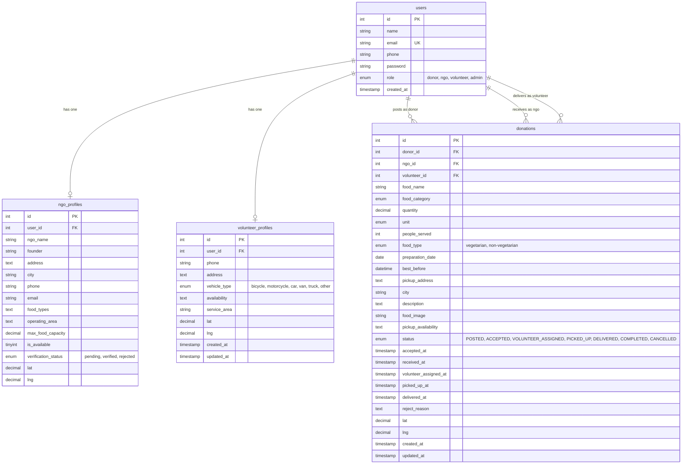

# FoodBridge – Comprehensive Project Documentation

---

## 1. Project Overview

**FoodBridge** is a full-stack, enterprise-grade food donation and redistribution platform designed to bridge the gap between surplus food sources (restaurants, hotels, banquet halls, supermarkets, and corporate cafeterias) and verified non-governmental organizations (NGOs), shelters, and volunteer logistics networks.

By digitizing surplus food declaration, automating discovery through a **Multi-Factor Smart Matching Engine**, forecasting consumption demand using **AI/ML predictive analytics**, and coordinating real-time volunteer pickup and delivery, FoodBridge minimizes food wastage while systematically combating hunger.

### Key Metrics & Scope
- **Domain**: Food Security, Logistics Optimization, Waste Reduction, Social Good
- **Application Type**: Multi-tier Responsive Web Application & REST API
- **Deployment Model**: Monorepo Architecture (`frontend/` + `backend/`)
- **Primary Beneficiaries**: Underprivileged populations, shelter residents, community kitchens

---

## 2. Problem Statement

Across urban centers worldwide, millions of metric tons of edible, safe, and nutritious food are discarded daily by commercial kitchens, events, and food retail establishments due to:
1. **Coordination Failure**: Donors lack reliable, instantaneous channels to notify nearby verified charities before perishable food spoils.
2. **Logistical Latency**: Small and medium NGOs often lack transport infrastructure or real-time couriers to pick up donations across the city.
3. **Demand & Supply Mismatch**: Surplus food often ends up in quantities or categories that an individual NGO cannot store or consume within food safety windows.
4. **Trust and Verification Deficit**: Without centralized oversight, food quality, hygiene standards, and NGO credibility remain unverified.

FoodBridge eliminates these bottlenecks through automated matching, verified NGO profiles, volunteer routing, and predictive demand analytics.

---

## 3. Objectives

- **Zero-Waste Redistribution**: Route surplus perishable and non-perishable food to beneficiaries prior to expiration.
- **Sub-Minute Discovery**: Connect donors to the most appropriate NGOs within seconds using intelligent algorithmic ranking.
- **End-to-End Traceability**: Provide full lifecycle status tracking (`POSTED` → `ACCEPTED` → `VOLUNTEER_ASSIGNED` → `PICKED_UP` → `DELIVERED` → `COMPLETED`).
- **Data-Driven Demand Planning**: Enable NGOs to anticipate daily and weekly food requirements using machine learning and historical intake models.
- **Administrative Transparency**: Empower platform administrators with role auditing, NGO verification workflows, and aggregate social impact metrics.

---

## 4. Proposed Solution

FoodBridge introduces an integrated 4-tier ecosystem:
- **Donation Hub (Donor Portal)**: A frictionless interface for commercial kitchens and individuals to log surplus food specifications, quantity, shelf life, and GPS/address coordinates.
- **Matching & Distribution Hub (NGO Portal)**: A unified dashboard where verified charities can evaluate match scores, accept suitable donations, track active deliveries, and inspect AI demand forecasts.
- **Logistics Dispatch (Volunteer Portal)**: A route-aware task dashboard allowing verified couriers to claim single pickup assignments and update progress milestones in real time.
- **Governance Console (Admin Portal)**: Centralized command center for platform verification, user management, and high-level social impact analytics.



---

## 5. Features

### Core Functional Capabilities
1. **Donation Management**: Full CRUD operations on donation postings, including dietary flags (Vegetarian/Non-Vegetarian), food categories, shelf-life timers, and high-resolution food photo uploads.
2. **Smart Matching Engine**: 7-factor automated scoring engine ranking NGOs based on proximity, capacity, dietary preferences, and availability.
3. **AI/ML Demand Prediction**: Hybrid Weighted Moving Average (WMA) + Ordinary Least Squares (OLS) regression engine with day-of-week and month seasonality multipliers.
4. **Role-Based Workflows**: Distinct interfaces and permissions for Donors, NGOs, Volunteers, and Admins.
5. **Interactive Mapping & Distance Tracking**: Leaflet-powered maps, address geocoding fallback, and Haversine GPS distance computation.
6. **Social Impact Visualizations**: Real-time Chart.js visual analytics tracking monthly food distributions, beneficiary reach, and category breakdowns.
7. **Single Active Pickup Safeguard**: Prevents volunteer task hoarding by enforcing a strict single-active-pickup policy.
8. **NGO Verification Workflow**: Multi-state NGO accreditation pipeline (`pending` → `verified` / `rejected`) controlled by platform administrators.

---

## 6. User Roles & Permissions

| Role | Access Permissions & Key Responsibilities |
|---|---|
| **Donor** | Post surplus donations, edit/cancel unassigned postings, view automated smart matches, upload food images, and monitor donation lifecycle. |
| **NGO** | Browse available donations, run smart matching, accept/reject surplus food, confirm final receipt, update operational profile and capacity, access AI demand predictions. |
| **Volunteer** | View nearby unclaimed pickup tasks, accept one active delivery at a time, update status milestones (`PICKED_UP`, `DELIVERED`), manage vehicle and service area profile. |
| **Admin** | Oversee all platform users, verify/reject NGO registrations, inspect all donation lifecycles, and access aggregate analytical dashboards. |

---

## 7. System Architecture



### Architectural Highlights
- **Decoupled Client & Server**: React single-page application served via Vite, consuming backend RESTful APIs via JWT authorization headers.
- **Connection Pooling**: Node `mysql2/promise` pool with configurable socket or TCP connections for high throughput and zero connection leaks.
- **Stateless Authentication**: Cryptographically signed JSON Web Tokens (HMAC-SHA256) ensuring horizontal scalability.

---

## 8. Database Schema

The relational database schema is structured into 4 core tables with foreign keys and index constraints:



---

## 9. API Documentation

### 9.1 Authentication (`/api/auth`)
- `POST /api/auth/register` – Register new user (`donor`, `ngo`, `volunteer`).
- `POST /api/auth/login` – Authenticate user and receive JWT bearer token.
- `GET /api/auth/me` – Retrieve profile of current authenticated user.
- `POST /api/auth/logout` – Clear auth session token.

### 9.2 Donor Endpoints (`/api/donor`)
- `GET /api/donor/dashboard` – Overall donor metrics, active donations, and monthly chart data.
- `GET /api/donor/donations` – List all donations posted by authenticated donor (supports `?status=` filter).
- `POST /api/donor/donations` – Post a new donation (supports `multipart/form-data` for food images).
- `GET /api/donor/donations/:id` – Retrieve complete details for a specific donation.
- `PUT /api/donor/donations/:id` – Update an existing donation prior to acceptance.
- `DELETE /api/donor/donations/:id` – Cancel a donation.

### 9.3 NGO Endpoints (`/api/ngo`)
- `GET /api/ngo/dashboard` – NGO summary statistics and recent activities.
- `GET /api/ngo/donations/available` – Browse all unclaimed food donations (`status=POSTED`). Supports filters (`category`, `food_type`, `city`, `min_qty`, `max_qty`, `expiry_hours`).
- `GET /api/ngo/donations/accepted` – View accepted donations awaiting pickup or delivery.
- `GET /api/ngo/donations/received` – View completed historical donations.
- `POST /api/ngo/donations/:id/accept` – Accept an available donation.
- `POST /api/ngo/donations/:id/received` – Confirm final receipt of food.
- `POST /api/ngo/donations/:id/reject` – Reject an accepted donation back to `POSTED` with reason.
- `GET /api/ngo/profile` / `PUT /api/ngo/profile` – Manage NGO profile, operational capacity, and availability.

### 9.4 Volunteer Endpoints (`/api/volunteer`)
- `GET /api/volunteer/dashboard` – Volunteer stats, active delivery, and available tasks.
- `GET /api/volunteer/pickups/available` – List unassigned donations requiring transport (`status=ACCEPTED`).
- `POST /api/volunteer/pickups/:id/accept` – Claim a pickup assignment (enforces single-active limit).
- `POST /api/volunteer/pickups/:id/pickup` – Confirm food collected from donor (`PICKED_UP`).
- `POST /api/volunteer/pickups/:id/deliver` – Confirm food delivered to NGO (`DELIVERED`).
- `GET /api/volunteer/profile` / `PUT /api/volunteer/profile` – Update vehicle type and service area.

### 9.5 Smart Matching Endpoints (`/api/matching`)
- `GET /api/matching/donations/:id/ngos` – Return top matching NGOs ranked by compatibility score (0–100).
- `GET /api/matching/donations/:id/top-ngo` – Return the single highest-rated NGO match.
- `POST /api/matching/donations/:id/ngos/:ngoId/accept` – Accept donation directly from matching results.

### 9.6 AI Demand Prediction Endpoints (`/api/ngo/predict`)
- `GET /api/ngo/predict` – Generate multi-category demand forecast for tomorrow (or `?date=YYYY-MM-DD`).
- `GET /api/ngo/predict?category=Cooked%20Food` – Generate focused demand prediction for a specific food category.
- `GET /api/ngo/predict/categories` – Metadata summary of historical completed donations per category.

### 9.7 Admin Endpoints (`/api/admin`)
- `GET /api/admin/dashboard` – System-wide health metrics, user distributions, and volume breakdown.
- `GET /api/admin/stats` – Aggregate numerical KPIs (total users, total food kg, people served).
- `GET /api/admin/users` – Paginated list of all users with role and text search.
- `GET /api/admin/ngos` – List all registered NGOs with verification statuses.
- `PATCH /api/admin/ngos/:id/verify` – Approve (`verified`), reject (`rejected`), or reset (`pending`) NGO status.
- `GET /api/admin/donations` – Paginated audit table of all donations across the system.

---

## 10. Smart Matching Algorithm

The FoodBridge **Smart Food Matching Engine** (`backend/matching/matchingEngine.js`) uses a deterministic 7-factor weighted scoring model that evaluates donor postings against all available, verified NGOs:

$$\text{Total Match Score} = \sum_{i=1}^{n} (S_i \times W_i) \quad \text{where } \sum W_i = 100$$

### Weight Distribution
| Factor | Weight ($W_i$) | Description & Scoring Logic |
|---|:---:|---|
| **Distance (Proximity)** | **28%** | Computed via Haversine GPS formula if coordinates are present; falls back to city and operating area string matching. $\le 2\text{km}=100$, $\le 5\text{km}=90$, $\le 10\text{km}=75$, $\le 20\text{km}=55$, $\le 40\text{km}=35$, $>40\text{km}=10$. |
| **Food Category** | **23%** | Evaluates whether the NGO accepts the specific category (e.g. Cooked Food, Dairy, Bakery). 100 if explicitly supported; 20 if unsupported. |
| **Freshness / Urgency** | **18%** | Prioritizes perishable food nearing expiration ($< 6\text{h} \rightarrow 100$, $< 12\text{h} \rightarrow 85$, $< 24\text{h} \rightarrow 70$, $> 24\text{h} \rightarrow 50$). |
| **Capacity Match** | **12%** | Assesses whether donation quantity fits within the NGO's declared storage capacity ($\text{quantity} \le \text{capacity} \rightarrow 100$; scaled linearly if larger). |
| **Dietary Compatibility** | **8%** | 100% for vegetarian donations; non-vegetarian items evaluated against NGO preference profile. |
| **Availability Status** | **6%** | Evaluates whether the NGO is currently marked active (`is_available = 1`). |
| **Operating Area** | **5%** | Evaluates explicit textual match between donor locality and NGO operational sectors. |

---

## 11. AI/ML Component: Demand Prediction Engine

The **Demand Prediction Engine** (`backend/ml/demandPredictor.js`) forecasts future food demand for each NGO using time-series analysis and regression over historical completed donations.

### Model Formulation
1. **Weighted Moving Average (WMA - 70% weight)**:
   Recent donations receive linearly increasing weights $w_i = i$:
   $$\text{WMA} = \frac{\sum_{i=1}^n x_i \cdot w_i}{\sum_{i=1}^n w_i}$$
2. **OLS Linear Regression (30% weight)**:
   Calculates rate of growth or reduction in daily demand over time:
   $$\hat{y} = \beta_0 + \beta_1 t$$
3. **Seasonality Indices**:
   - **Day-of-Week Factor ($DOW$)**: Adjusts for higher weekend or weekday consumption patterns ($\text{Factor range: } 0.88 - 1.08$).
   - **Monthly Factor ($M$)**: Adjusts for seasonal variations and festive periods ($\text{Factor range: } 0.95 - 1.08$).

$$\text{Final Prediction} = \Big(0.70 \cdot \text{WMA} + 0.30 \cdot \hat{y}\Big) \times DOW \times M$$

### Confidence Scoring
- **High Confidence**: $\ge 10$ historical data points with $R^2 \ge 0.70$ and low variance.
- **Medium Confidence**: $5 - 9$ historical data points.
- **Low Confidence**: $3 - 4$ historical data points.
- **Insufficient Data**: $< 3$ observations (returns baseline advisory message).

---

## 12. Testing Strategy & Results

The test suite is built on **Jest** and **Supertest**, executing against an isolated MySQL database connection:

### Test Suites Overview
| Test Suite | File | Focus Areas | Tests | Status |
|---|---|---|:---:|:---:|
| **Authentication** | `tests/auth.test.js` | Registration validation, JWT issuance, password hashing, role restrictions | 17 | ✅ Passed |
| **Donations** | `tests/donations.test.js` | Posting CRUD, photo handling, best-before validation, lifecycle transitions | 18 | ✅ Passed |
| **NGO Operations** | `tests/ngo.test.js` | Filtering available donations, accept/reject logic, receipt confirmation | 16 | ✅ Passed |
| **Volunteer Logistics** | `tests/volunteer.test.js` | Claiming pickups, single-active constraint, status progression | 14 | ✅ Passed |
| **Admin Governance** | `tests/admin.test.js` | User pagination, NGO verification, system-wide metrics aggregation | 12 | ✅ Passed |
| **Smart Matching** | `tests/matching.test.js` | 7-factor scoring weights, Haversine calculations, fallback string logic | 8 | ✅ Passed |
| **Demand Prediction** | `tests/prediction.test.js` | WMA calculation, OLS regression slope, seasonality adjustments | 8 | ✅ Passed |
| **Security & RBAC** | `tests/security.test.js` | SQL injection protection, privilege escalation safeguards, token tampering | 10 | ✅ Passed |
| **Total** | | **All 8 Test Suites** | **103** | **✅ 100% Passed** |

---

## 13. Security Implementation

- **Bcrypt Password Hashing**: Passwords hashed with salt cost factor 10 prior to persistence.
- **Role-Based Access Control (RBAC)**: Strictly enforced at route layer using `authenticate` and `authorize(roles...)` middleware.
- **Privilege Escalation Prevention**: Registration endpoint explicitly prohibits signing up as `admin`.
- **HTTP Security Headers**: Native protection against clickjacking and MIME-sniffing:
  - `X-Content-Type-Options: nosniff`
  - `X-Frame-Options: DENY`
  - `X-XSS-Protection: 1; mode=block`
- **Location Privacy**: Specific GPS latitude/longitude coordinates are used solely for distance calculation on the backend and are omitted from untrusted public queries.
- **SQL Injection Defense**: All database transactions utilize parameterized SQL queries (`?` placeholders).

---

## 14. Future Scope

1. **Push Notifications & WebSockets**: Real-time alerts for donors and NGOs when a donation is posted, claimed, or delivered.
2. **Automated Route Optimization**: Multi-stop routing for volunteers collecting from multiple donors in a single circuit.
3. **Mobile Application**: Native iOS/Android apps with offline sync for volunteers in areas with intermittent cellular connectivity.
4. **IoT Temperature & Quality Sensors**: Smart sensor integration for refrigerated food transit to ensure cold-chain compliance.
5. **Blockchain Audit Trail**: Immutable ledger of food redistribution for corporate CSR auditing and tax deduction compliance.

---

## 15. Installation & Deployment Instructions

### System Prerequisites
- **Node.js**: v18.0.0 or higher
- **npm**: v9.0.0 or higher
- **MySQL**: v5.7+ or v8.0+

### Step-by-Step Installation

```bash
# 1. Clone repository and navigate to root directory
cd CEP_Project

# 2. Configure Backend
cd backend
npm install
cp .env.example .env
# Edit .env with your MySQL credentials, JWT secret, and PORT

# 3. Seed Database with Initial Data
npm run seed

# 4. Run Backend Test Suite
npm test

# 5. Start Backend Server
npm run dev    # Starts API on http://localhost:5000

# 6. Configure & Launch Frontend (In a separate terminal)
cd ../frontend
npm install
cp .env.example .env
npm run dev    # Starts Vite dev server on http://localhost:5173
```

### Production Build & Deployment

```bash
# Frontend Production Bundle
cd frontend
npm run build
# Distributable static files generated in frontend/dist/

# Backend Production Launch
cd ../backend
NODE_ENV=production CLIENT_URL=https://your-domain.com npm start
```
